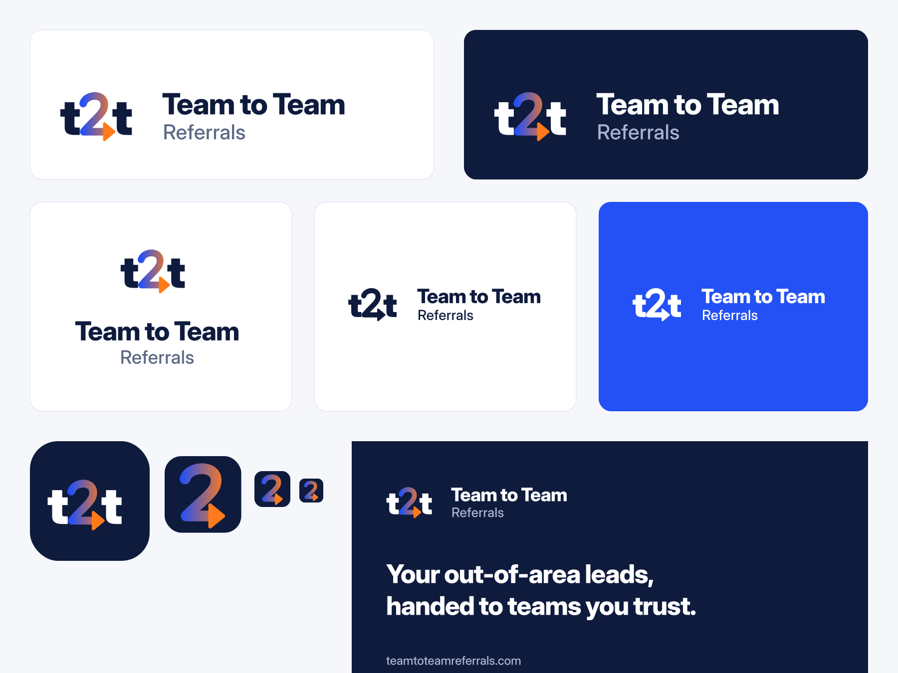

# Brand guide

## Name

- Full name: **Team to Team Referrals**. Domain: **teamtoteamreferrals.com**.
- Short name: **t2t**, always lowercase. Use it for the app icon, social handles, push notifications and anywhere space is tight.
- In running text, write "Team to Team Referrals" on first mention and "Team to Team" after that. Never "T2T Referrals" or "TeamToTeam".

## Logo

The mark is a **t2t** lettermark. The "2" is an arrow, so the mark reads "team to team": a lead passed from one team to another. The arrow runs from Relay Cobalt (the sending team) to Handoff Orange (the receiving team).

| File | Use |
| --- | --- |
| `brand/logo/t2t-logo-horizontal.svg` | Default logo on light backgrounds (site header, emails, documents) |
| `brand/logo/t2t-logo-horizontal-on-dark.svg` | Dark backgrounds, dark mode |
| `brand/logo/t2t-logo-stacked.svg` / `-on-dark.svg` | Square or narrow spaces (sign-in card, social posts) |
| `brand/logo/t2t-logo-mono-navy.svg` / `-mono-white.svg` | One-colour printing, embossing, photos and coloured backgrounds |
| `brand/logo/t2t-mark.svg` / `-on-dark.svg` | Mark alone, where the name appears nearby |
| `brand/icons/app-icon.svg`, `icon-192.png`, `icon-512.png`, `icon-maskable-512.png`, `apple-touch-icon.png` | App, PWA and home-screen icons |
| `brand/icons/favicon.svg`, `favicon.ico`, `favicon-16/32/48.png` | Browser tabs. Uses the arrow-2 alone, because the full mark is too fine below 48 px |
| `brand/social/og-image.png` | Link previews (1200 × 630) |
| `brand/social/avatar-400.png` | Social profile pictures |

All lettering is outlined, so the files render the same everywhere without fonts. To regenerate after a change: `cd tools/brand && python3 build.py`.

**Rules**

- Clear space around the logo: at least the height of the "t" on every side.
- Minimum size: horizontal logo 120 px wide on screen (30 mm in print); mark 24 px.
- Never recolour the arrow, stretch, rotate, outline, add shadows, or place the colour logo on busy photos (use the mono white version).
- On cobalt or orange backgrounds, use the mono white logo.

## Colour

Two brand colours stand for the two sides of every referral. This pairing is used with meaning across the product, not as decoration.

| Name | Hex | Role |
| --- | --- | --- |
| Relay Cobalt | `#2451F5` | Primary actions, links, the **sending** team |
| Handoff Orange | `#FF7A1A` | Highlights, the arrow, the **receiving** team |
| Deep Navy | `#0E1B3D` | Text, dark surfaces |
| Slate | `#5B6785` | Secondary text |
| Mist | `#F6F7FB` | Page background (light mode) |

**The relay rule (signature of the product):** wherever a referral moves between two teams, the sender is cobalt and the receiver is orange — timeline dots, message bubbles, "sent vs received" chart series, the network map. Users learn the meaning once and read it everywhere.

**Lead temperature:** Hot `#D7263D`, Warm `#B45309`, Future `#6D28D9`. Always paired with a label or icon, never colour alone.

**Semantic:** success `#15803D`, warning `#A16207`, danger `#D7263D`, info `#1D6FD8`.

Full scales (50–900) and light and dark themes are in `design/tokens.json`.

**Contrast (WCAG 2.1)** — checked pairs:

| Text on background | Ratio | Allowed for |
| --- | --- | --- |
| Navy on white | 16.9 | All text |
| Slate `#5B6785` on white | 5.6 | All text |
| Cobalt on white / white on cobalt | 5.9 | All text, buttons |
| Navy on orange | 6.5 | Orange buttons and badges (never white on orange) |
| Orange `#FF7A1A` on white | 2.6 | **Not for text.** Use orange-700 `#C04F08` (4.8) for orange text |
| Navy-500 `#6B7896` on white | 4.4 | Large text (18 px+) and icons only |
| White on navy | 16.9 | All text |
| `#AAB4CE` on navy | 8.2 | Secondary text in dark mode |

## Typography

- **Inter Display** for headings and large numbers (weights 600–800, tracking −2.2%).
- **Inter** for everything else (400–600). Tabular figures (`font-variant-numeric: tabular-nums`) in tables, KPIs and money so columns align.
- Two families from one design keep pages fast (one font download, variable weights) and give dashboards the calm, precise feel of the market leaders.
- Type scale (px): 12, 14, 16, 18, 20, 24, 30, 36, 48, 60. Body 16 px, line height 1.5; headings 1.15–1.3.
- Sentence case everywhere: headings, buttons, labels, menus. No all-caps labels.

## Imagery and icons

- Photography: real agents and teams at work, natural light, diverse, never staged stock handshakes. Licensed images only.
- Illustrations: simple geometric scenes using the two brand colours on navy or white; the arrow motif may appear as a connecting line between two places or people.
- Icons: Lucide (outline, 1.5 px stroke at 24 px, rounded joins), sized 16/20/24.

## Voice and tone

- Plain, confident, specific. We speak like a top producer helping a peer, not like a software vendor.
- Lead with what the user gets: "Send this lead to Houston" beats "Initiate referral workflow".
- Actions keep one name through a flow: the button "Send referral" produces "Referral sent".
- Errors say what happened and how to fix it; they don't apologise. Empty screens invite the next action.
- Numbers over adjectives: "Accepted in 14 minutes" beats "Fast response".

**Examples**

| Instead of | Write |
| --- | --- |
| Submit | Send referral |
| Your request has been processed successfully! | Referral sent to Houston. Chris has 24 hours to accept. |
| No data available | No referrals yet. Send your first one in under a minute. |
| Error 422 | Add the lead's phone number or email so Chris can reach them. |
