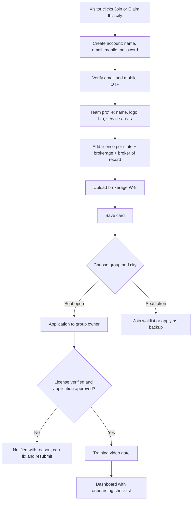
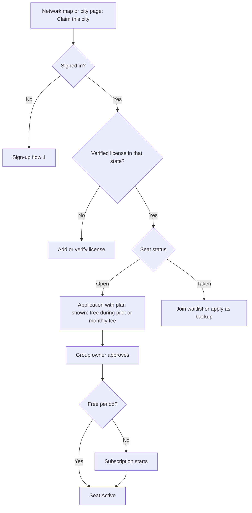
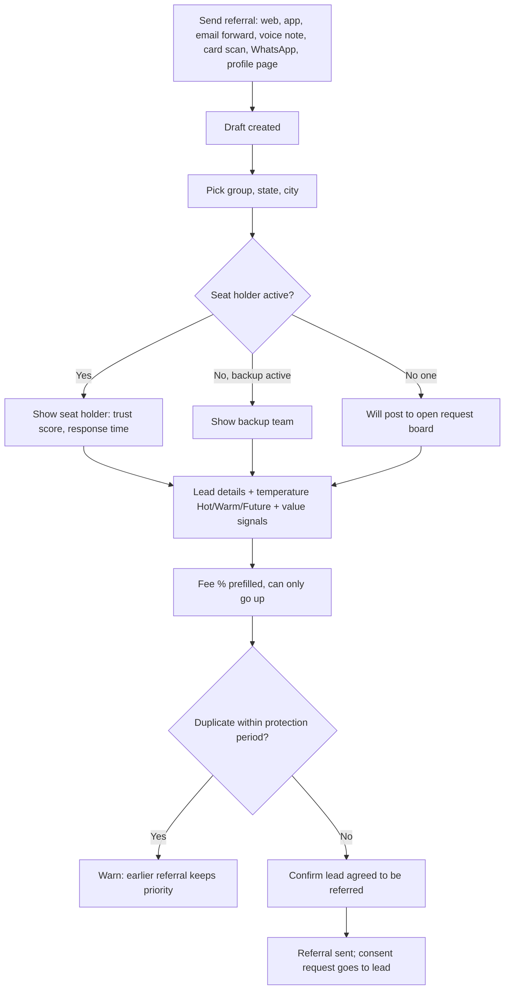
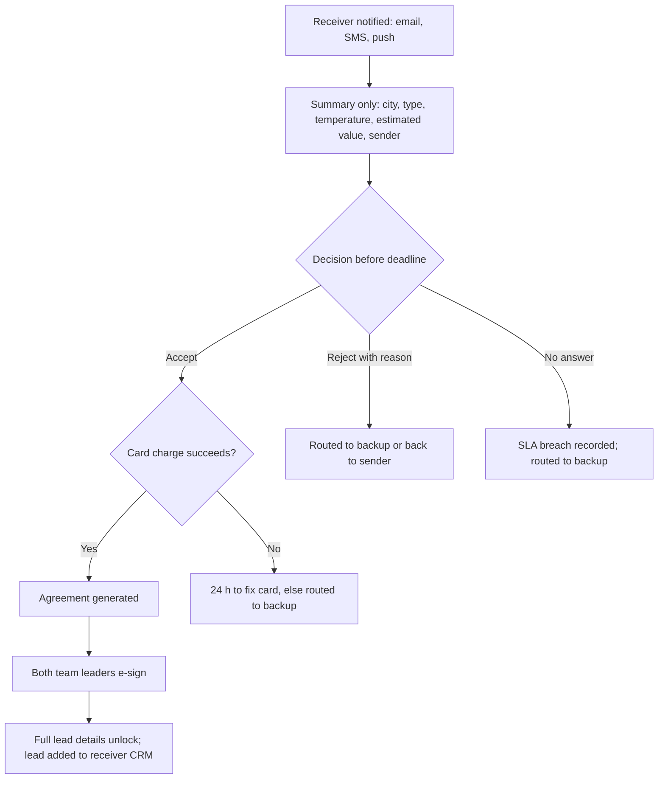
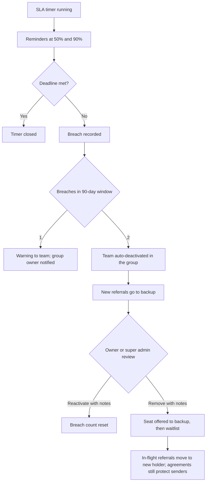
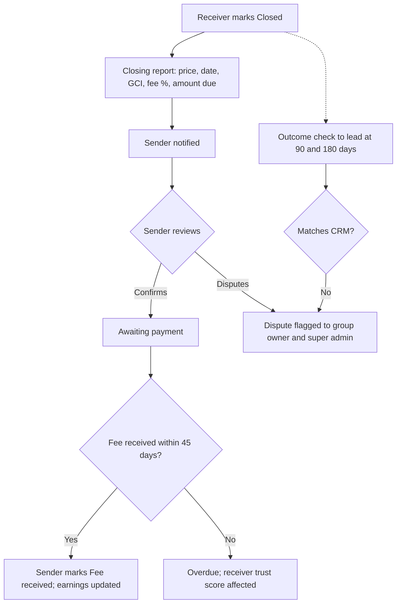
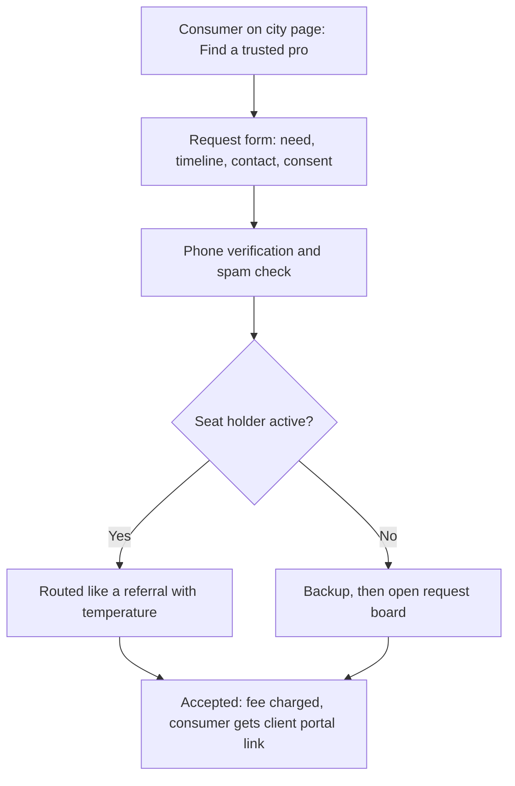
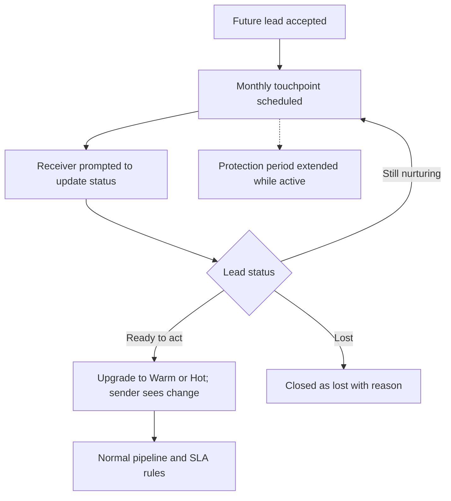
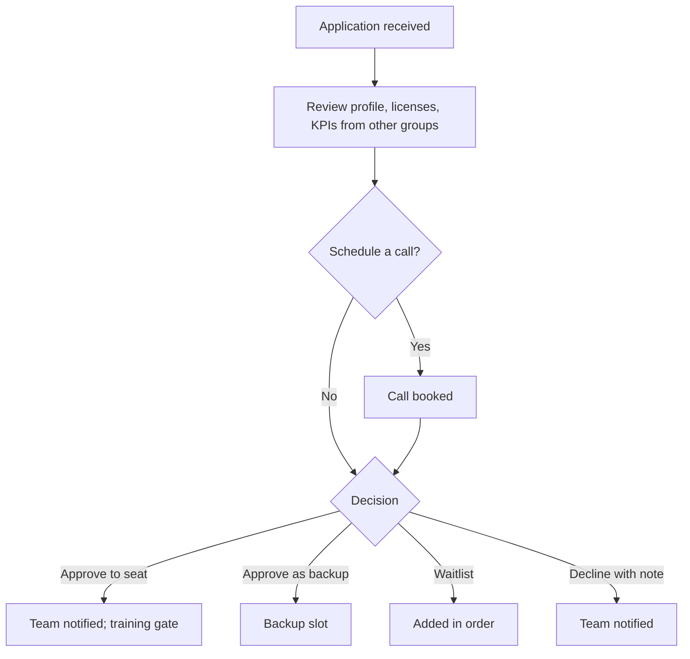
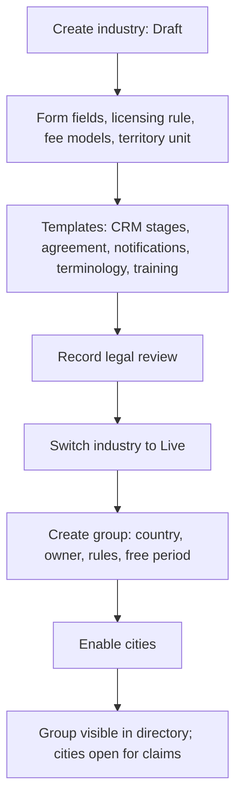

# Core user flows

Ten journeys that every later sprint must support. Diagrams render on GitHub (Mermaid).

## 1. Sign-up and onboarding

## 2. Claiming a city

## 3. Sending a referral

## 4. Accepting and signing

## 5. Deadline breach to deactivation

## 6. Closing report and fee confirmation

## 7. Consumer request

## 8. Nurture lead lifecycle

## 9. Group owner approvals

## 10. Super admin creates an industry and a group

